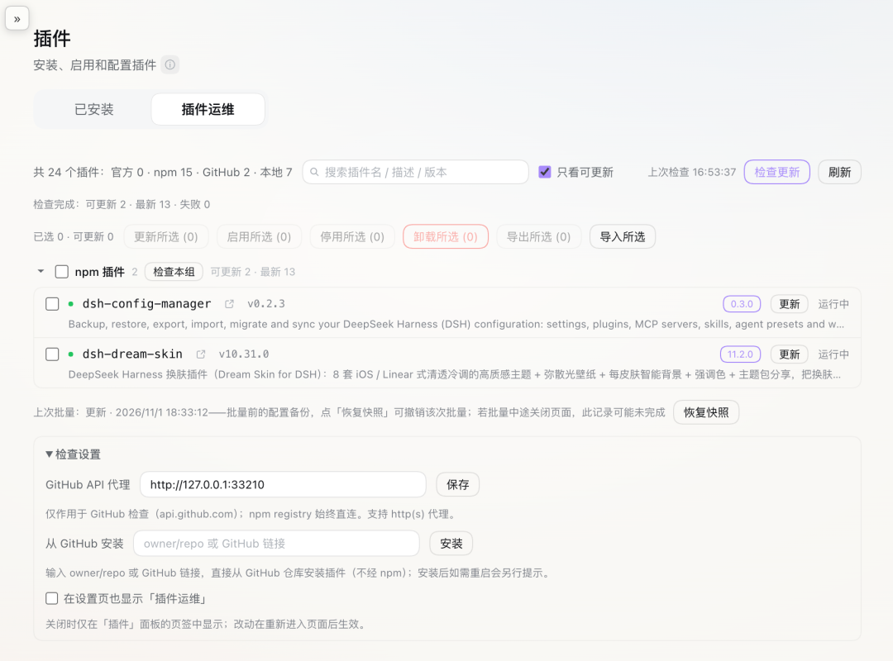

# dsh-plugin-keeper

[English](#english) | [中文](#中文)



## English

A plugin ops console for DeepSeek Harness (DSH 0.2.x): inventory the installed plugins, update / enable / disable / remove them in bulk, export and import them, install straight from GitHub, and search the list.

It only manages plugins you already have. No marketplace, no hot restart — the host requires a process restart when package contents change.

*The sidebar Plugins page → "插件运维" tab*

### What you can do

- See every plugin installed in the current profile in one place, grouped by where it came from (official / npm / GitHub / local)
- Find out which ones have a newer version and update them in bulk
- Enable, disable or remove plugins in bulk
- Export selected plugins (with their config) into a zip, and import that zip on another machine
- Install a plugin straight from GitHub
- Search the list by package name, description or version

### How to use it

- The panel lives in the sidebar Plugins page → "插件运维 / Plugin Ops" tab; it can also be shown in Settings
- Tick the rows you want, pick an action; a dialog lists what will be touched before anything runs
- Enable and disable take effect right away; updates and removals need a restart
- Export downloads a zip you can copy to another machine; import shows you what will happen before installing anything
- Type a package name fragment in the search box to filter; the matched parts are highlighted

### When it helps

- Moving to a new machine: export the plugins you use and import them there
- Cleaning up after a burst of installs: review, then disable or remove in bulk
- Routine upkeep: one click to see what is outdated, then update in bulk

### Install

```bash
dsh plugin add dsh-plugin-keeper
```

Restart dsh after installing (package changes require a process restart).

### Compatibility

| Item | Requirement |
|---|---|
| DSH | `>=0.2.0-rc.2 <0.3.0` |
| Node | `>=20` |

### First run

1. Open sidebar Plugins → "插件运维": plugins are grouped by source and the totals match `dsh plugin ls`
2. Click "Check updates": the badges match the latest versions on npm / GitHub
3. Select a non-official plugin → "Disable": the row immediately shows disabled; enabling it works the same way
4. Type a package name fragment in the search box: the list narrows and the matched parts are highlighted; Esc or × restores the full list

### Roadmap

- Later: desktop profile adaptation, experimental items (nav icon injection, deep embedding in the official page)

### License

MIT

---

## 中文

DeepSeek Harness (DSH 0.2.x) 的插件运维台：盘点已装插件、批量更新启停卸载、导出导入、GitHub 直装、搜索。

只管已装的插件；不做插件市场，也不做热重启（宿主要求包内容变更必须重启进程）。

*侧栏「插件」→「插件运维」页签*

### 能做什么

- 在一个页面里看全当前 profile 的插件，按来源分组（官方 / npm / GitHub / 本地）
- 查哪些插件有新版本，然后批量更新
- 批量启用、停用、卸载
- 把选中的插件（连同配置）导出成 zip，在另一台机器导入
- 直接从 GitHub 装插件
- 按包名、简述或版本搜插件

### 怎么用

- 面板在侧栏「插件」→「插件运维 / Plugin Ops」页签；也可以在设置页开一个同名入口
- 勾选要处理的行 → 选动作 → 执行前弹框会列出将要处理的包名
- 启用与停用立即生效；更新与卸载需要重启
- 导出后浏览器会下载 zip，拷到另一台机器导入；导入会先给你看会发生什么，确认后才装
- 搜索框输入包名片段即可过滤，命中的部分会高亮

### 什么时候用

- 换机器：把在用的插件导出，到新机器导入
- 装了一堆想清理：统一勾选后批量停用或卸载
- 日常维护：点一次看清哪些过期，再批量更新

### 安装

```bash
dsh plugin add dsh-plugin-keeper
```

安装后重启 dsh（包内容变更需要进程重启生效）。

### 兼容性

| 项 | 要求 |
|---|---|
| DSH | `>=0.2.0-rc.2 <0.3.0` |
| Node | `>=20` |

### 上手检查

1. 打开侧栏「插件」→「插件运维」，插件按来源分组，总数与 `dsh plugin ls` 一致
2. 点「检查更新」，徽标与 npm / GitHub 网页上的最新版本对得上
3. 勾一个非官方插件 →「批量停用」，该行状态立刻变成「已停用」；再启用同样立刻恢复
4. 在搜索框输入包名片段，列表收敛，命中的部分高亮；Esc 或 × 恢复全量

### Roadmap

- 后续：desktop profile 适配验证、nav 图标与深度嵌入官方页等实验项

### License

MIT
